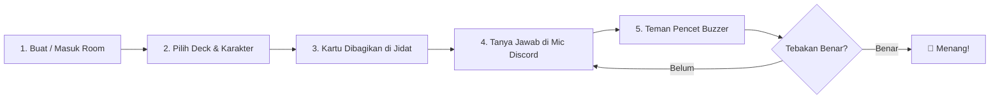

# 🎭 WhoAmI? - Tebak Karakter Tongkrongan

<p align="center">
  
</p>

<p align="center">
  <strong>Web party game tebak karakter & identitas di jidat untuk seru-seruan bareng teman via Discord Voice atau kumpul offline.</strong>
</p>

<p align="center">
  <a href="https://who-am-i-zepher.vercel.app/">
    
  </a>
</p>

<p align="center">
  
  
  
  
  
  
</p>

---

## 🌐 Tautan Langsung

Mainkan langsung di browser tanpa perlu install aplikasi apapun:  
👉 **[WhoAmI? - Tebak Karakter Tongkrongan](https://who-am-i-zepher.vercel.app/)**

---

## 📖 Tentang Permainan

**WhoAmI?** mengadaptasi game klasik *"kartu di jidat"* (*Hedbanz / 20 Questions*) ke format web interaktif modern:
1. Setiap pemain mendapatkan **satu karakter rahasia** di layarnya, tetapi kartu miliknya disensor (`???`).
2. Pemain **lain di room dapat melihat** karakter tersebut secara jelas.
3. Pemain yang sedang gilirannya bertanya melalui voice chat (*"Apakah aku manusia?", "Apakah aku ninja dari Konoha?"*).
4. Teman-teman satu room merespons secara real-time lewat tombol buzzer: **🟢 YA**, **🔴 TIDAK**, atau **🟡 BISA JADI**.

Dirancang khusus agar seru dimainkan saat nongkrong di **Discord Voice Channel**, **WhatsApp Group Call**, **Google Meet**, maupun **tatap muka langsung** di cafe!

---

## ✨ Fitur Unggulan

| Fitur | Deskripsi |
| :--- | :--- |
| 🛡️ **Anti-Cheat Jidat Digital** | Kartu sendiri tertutup rapat dengan sensor otomatis; hanya teman di room yang bisa melihat identitasmu. |
| ⚡ **Multiplayer Real-Time P2P** | Menggunakan arsitektur WebRTC (*PeerJS*) dengan fallback Socket.IO untuk latensi super rendah dan bebas lag. |
| 🍥 **Preset Shinobi Deck (Naruto Universe)** | 140+ karakter lengkap dengan avatar, lencana desa shinobi, dan tingkat kesulitan (*Easy, Medium, Hard, Extreme*). |
| ✍️ **Custom Secret Deck (Derangement)** | Setiap pemain bisa menulis karakter kustom sendiri. Diacak dengan algoritma matematika *Derangement* sehingga **dijamin tidak ada yang mendapat kartu buatannya sendiri**. |
| 🔔 **Interactive SFX & Buzzers** | Reaksi instan dengan synthesizer Web Audio API (*Ding, Buzzer, Chime*) tanpa beban aset audio eksternal yang berat. |
| 🎉 **Selebrasi Kemenangan** | Efek konfeti partikel real-time saat tebakan berhasil ditebak dengan benar. |
| 📱 **Mobile & Dark-Mode First** | Tampilan futuristik gelap yang nyaman di mata, dioptimasi penuh untuk layar HP maupun desktop. |
| 🚀 **Performa 100/100 Lighthouse** | Skor sempurna untuk Performance, Accessibility, Best Practices, dan SEO. |

---

## 🎮 Cara Bermain (Gameplay Rules)



1. **Buat Room:** Host membuat room baru, lalu membagikan **Room Code** atau link langsung ke teman-teman.
2. **Pengaturan:** Pilih kategori kartu (*Preset Naruto* dengan filter level kesulitan, atau *Custom Secret Deck*).
3. **Mulai Game:** Setiap pemain akan melihat karakter milik teman-temannya di layar, sementara karakternya sendiri tertutup label rahasia `???`.
4. **Giliran Bertanya:** Pemain bertanya di voice chat hanya dengan pertanyaan tertutup yang bisa dijawab "Ya / Tidak".
5. **Respons Cepat:** Pemain lain menekan tombol suara **🟢 YA**, **🔴 TIDAK**, atau **🟡 BISA JADI**.
6. **Tebak Siapa Kamu:** Jika berhasil menebak nama karakternya sebelum batas waktu habis, tekan tombol **Selesai / Tebak Benar** untuk merayakan kemenangan!

---

## 🛠️ Tech Stack

- **Frontend:** [React 19](https://react.dev/), [Vite 8](https://vitejs.dev/), [Tailwind CSS v4](https://tailwindcss.com/)
- **Icons & Visuals:** [Lucide Icons](https://lucide.dev/), [Canvas-Confetti](https://www.npmjs.com/package/canvas-confetti)
- **Realtime Networking:** [PeerJS](https://peerjs.com/) (WebRTC P2P) & [Socket.IO](https://socket.io/)
- **Audio Engine:** Web Audio API (Synthesized Realtime SFX)
- **Deployment & Hosting:** [Vercel](https://vercel.com/) (Frontend SPA) & Node.js / Express (Signaling Server)

---

## 🚀 Menjalankan Proyek Secara Lokal

Pastikan Anda telah menginstal **Node.js** (versi 18 atau lebih baru).

### 1. Clone Repositori
```bash
git clone https://github.com/mhmdilham/WhoAmI.git
cd WhoAmI
```

### 2. Instal Dependensi
```bash
npm install
```

### 3. Jalankan Development Server
```bash
# Jalankan frontend Vite (port 5173)
npm run dev

# (Opsional) Jalankan signaling backend server jika diperlukan (port 3000)
npm run server
```

Buka browser Anda dan akses: `http://localhost:5173/`

### 4. Build untuk Produksi
```bash
npm run build
```

---

## 📂 Struktur Proyek

```
WhoAmI/
├── public/
│   ├── characters/        # Aset gambar 140+ karakter shinobi
│   ├── robots.txt         # Aturan crawler bot
│   └── sitemap.xml        # Sitemap SEO
├── src/
│   ├── components/
│   │   ├── lobby/         # Pengaturan game & daftar pemain
│   │   ├── GameBoard.jsx  # Papan permainan & kartu jidat
│   │   ├── Home.jsx       # Halaman landing & buat/gabung room
│   │   ├── Lobby.jsx      # Ruang tunggu sebelum permainan dimulai
│   │   └── SecretInput.jsx# Form input kartu rahasia kustom
│   ├── data/
│   │   └── characters.js  # Database karakter & metadata level
│   ├── utils/
│   │   ├── derangement.js # Algoritma acak kartu tanpa duplikasi diri
│   │   ├── peerService.js # Koneksi P2P WebRTC
│   │   └── sound.js       # Synthesizer Web Audio API buzzer
│   ├── App.jsx            # Komponen utama aplikasi
│   └── main.jsx           # Entry point React
├── index.html             # Shell HTML + Meta Tags Open Graph & SEO
├── package.json           # Dependensi & skrip npm
├── vercel.json            # Konfigurasi Vercel & HTTP Security Headers
└── vite.config.js         # Konfigurasi build Vite & Tailwind
```

---

## 👨‍💻 Pembuat (Author)

Dibuat dengan ❤️ oleh **[Muhammad Ilham](https://github.com/mhmdilham)**

Jika Anda menyukai proyek ini, silakan beri ⭐ di [GitHub](https://github.com/mhmdilham/WhoAmI)!

---

## 📄 Lisensi & Catatan Komunitas

Proyek ini dirilis di bawah lisensi [MIT License](LICENSE).

> **Disclaimer:** *WhoAmI?* adalah proyek web game buatan penggemar non-komersial (*fan-made project*). Seluruh hak cipta nama karakter, aset ilustrasi, dan konsep dunia ninja adalah milik **Masashi Kishimoto**, **Shueisha**, **Studio Pierrot**, dan **TV Tokyo**.
